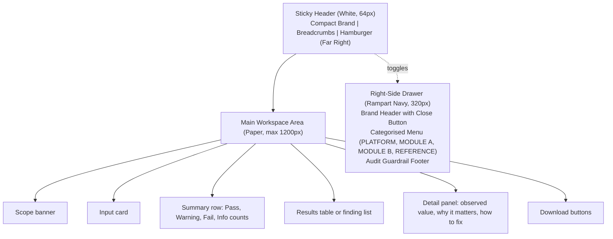

# Design System

Product: Tellwarden (provisional name, pending clearance)
Version: 0.1 draft for approval
Date: 25 October 2026
Related: `PRD.md` (UI-01 to UI-07, A11Y-01 to A11Y-06), `TEST_PLAN.md` (TC-A11Y, TC-DOC-02, TC-DOC-03)
Evidence tags: see `README.md`.

## 1. Design principles

1. **Clear before clever.** Plain layout, readable text, obvious next action.
2. **Sober and technical.** A conventional security utility. No glow, neon, robot imagery, neural-network graphics, circuit patterns or other AI motifs. No gradients.
3. **Colour has a job.** Brand colours carry identity and actions. Status colours carry status only.
4. **Never colour alone.** Every status has an icon shape and a text label.
5. **Monospace for machine values.** IP addresses, headers, ports, rule IDs, timestamps and logs use the monospace font.
6. **Honest interface.** Scope and limit banners are part of the design, not hidden.

**[Verified or Docs, not re-fetched]** Reference systems that share this approach: GitHub Primer, IBM Carbon (status indicators use shape and text as well as colour), Atlassian Design System, Grafana and the Wazuh dashboard. **[Recommendation]** Borrow Carbon's status pattern and Primer's table density. These systems were not reopened during research. See `REFERENCES.md`.

## 2. Four-colour core palette

Contrast ratios use the WCAG 2.x relative-luminance formula. They were computed in the research and recomputed when these documents were prepared. White is `#FFFFFF`.

| Role | Name | HEX | vs White | vs Paper `#F8FAFC` | Intended use |
|---|---|---|---|---|---|
| Primary brand | **Rampart Navy** | `#1B365D` | 12.12:1 | 11.59:1 | Headings, sidebar background, logotype, primary text on light surfaces |
| Secondary | **Slate** | `#475569` | 7.58:1 | 7.24:1 | Body and secondary text, borders, table headers, icons |
| Accent | **Signal Teal** | `#0F766E` | 5.47:1 | 5.23:1 | Primary buttons, links, focus ring, selected state |
| Neutral and background | **Paper** | `#F8FAFC` | n/a | n/a | App background. Cards use white `#FFFFFF` |

Accessibility notes:

- All text pairings in the table meet WCAG AA for normal text (4.5:1). Navy and Slate also meet AAA (7:1).
- White text on Signal Teal is 5.47:1, so teal buttons with white labels pass AA.
- The teal focus ring on Paper is 5.23:1, above the 3:1 minimum for non-text elements.
- White text on Rampart Navy is 12.12:1, so a navy sidebar with white text passes.
- Do not place Signal Teal text on Rampart Navy (2.21:1, fails).
- White `#FFFFFF` is a surface (card) colour and is part of the neutral role, not a fifth brand colour.

## 3. Semantic status tokens

Status colours are **supplementary semantic tokens, not brand colours.** They are used only to show status. They are never used for decoration, headings or buttons.

| Token | HEX | vs White | vs Paper | Scanner status | Required non-colour cue |
|---|---|---|---|---|---|
| Success | `#166534` | 7.13:1 | 6.81:1 | Pass | Check mark icon and the word "PASS" |
| Warning | `#B45309` | 5.02:1 | 4.80:1 | Warning | Triangle icon and the word "WARNING" |
| Error | `#B91C1C` | 6.47:1 | 6.18:1 | Fail | Cross icon and the word "FAIL" |
| Info (uses Slate) | `#475569` | 7.58:1 | 7.24:1 | Info | Circle "i" icon and the word "INFO" |

Notes:

- Info reuses Slate, so it adds no new colour.
- Success and Error have similar luminance (0.097 and 0.112), so people with red-green colour blindness may not tell them apart by colour. This is why icon shape and text are mandatory (A11Y-03).
- Warning on Paper is 4.80:1. It passes AA but with little margin. Use it only at body size or larger, and always with the label.
- Light tint backgrounds for badges (for example a 10% tint of the status colour) may be used. Text on a tint must still reach 4.5:1. Verify each tint with the contrast test (TC-A11Y-01).
- IDS severity (Low, Medium, High, Critical) uses text labels and a numeric rank. Severity does not use new colours. High and Critical use the Error token, Medium uses the Warning token, Low uses Slate. The label is always shown.

### 3.1 Derived navigation tokens (Owner override 25 October 2026)

The following derived tokens support the right-side drawer navigation on Rampart Navy surfaces:

| Token | HEX | Use | Contrast ratio |
|---|---|---|---|
| `nav-text` | `#E2E8F0` | Item labels on navy | 9.83:1 on `#1B365D` (Passes AAA) |
| `nav-label` | `#A9B8CC` | Category group captions on navy | 6.01:1 on `#1B365D` (Passes AA) |
| `nav-hover` | `#27466F` | Item hover background | `#E2E8F0` on it is 7.77:1 (Passes AAA) |
| `nav-active-bg` | `#FFFFFF` | Active item pill background | `#1B365D` text on it is 12.12:1 (Passes AAA) |
| `focus-on-navy` | `#FFFFFF` | Focus ring on navy drawer elements | 12.12:1 on `#1B365D` (Passes AA 3:1 non-text) |
| `border-light` | `#CBD5E1` | Subtle container borders and outlines | Decorative border only, never text |

The teal focus ring is for light surfaces only. On navy surfaces, use the white focus ring.

## 4. Typography (Owner override O-1, 25 October 2026)

**Active pairing: DM Sans + IBM Plex Mono.**

| Role | Font | Weights | Fallback stack |
|---|---|---|---|
| Interface and body | DM Sans | 400, 500 | `"DM Sans", system-ui, -apple-system, "Segoe UI", Roboto, sans-serif` |
| Headings | DM Sans | 600 (SemiBold) | Same as above |
| Monospace | IBM Plex Mono | 400 | `"IBM Plex Mono", ui-monospace, "SFMono-Regular", Consolas, monospace` |

Why this pairing: DM Sans provides crisp geometric clarity for headers and modern interface layouts, while IBM Plex Mono ensures unmistakable character distinction (`0` vs `O`, `1` vs `l` vs `I`) essential for IP addresses, headers, rule IDs, and event logs.

**Licence and availability:** SIL Open Font License 1.1. Self-hosted in `static/fonts/`. Full license text in `static/fonts/OFL.txt`.

### Alternatives considered

| | Pairing B | Pairing C |
|---|---|---|
| Body and headings | Inter 400, 500, 600 | Atkinson Hyperlegible Next 400, 700 |
| Monospace | JetBrains Mono 400 | Atkinson Hyperlegible Mono 400 |
| Licence | SIL OFL 1.1 **[Assumption]** | SIL OFL 1.1 **[Assumption]** |
| Fallback | `Inter, system-ui, "Segoe UI", Roboto, sans-serif`; `"JetBrains Mono", ui-monospace, Consolas, monospace` | `"Atkinson Hyperlegible Next", system-ui, sans-serif`; `"Atkinson Hyperlegible Mono", ui-monospace, monospace` |
| Why | Very legible at small sizes. Tall x-height in the mono font suits logs | Accessibility-first letter shapes. Good for low-vision readers |
| Why not first choice | Two unrelated families | Less technical tone. Newer family, less common in dashboards |

### Loading in Streamlit and performance

- Self-host WOFF2 files in `static/fonts/`: `DMSans-Regular.woff2`, `DMSans-Medium.woff2`, `DMSans-SemiBold.woff2`, and `IBMPlexMono-Regular.woff2`. Set `server.enableStaticServing = true`. Declare each file in `[[theme.fontFaces]]`. Set `font`, `headingFont` and `codeFont` in the `[theme]` section.
- Self-hosting avoids sending each visitor's IP address to a third-party font host. Zero external font network requests are made.
- Total font payload is under 60 KB across all four files.
- If a font fails to load, the fallback stack keeps the layout readable without layout breakage.

### Type scale

| Style | Size | Weight | Line height |
|---|---|---|---|
| Page title (H1) | 28 px | 600 | 1.25 |
| Section title (H2) | 22 px | 600 | 1.3 |
| Subsection (H3) | 18 px | 600 | 1.35 |
| Body | 16 px | 400 | 1.5 |
| Small and captions | 14 px | 400 | 1.45 |
| Monospace values | 14 px | 400 | 1.45 |

Body text is never smaller than 14 px. Line length for prose stays under about 75 characters.

## 5. Spacing scale

Base unit 4 px. Allowed steps: 4, 8, 12, 16, 24, 32, 48. Card padding 16 or 24. Gap between cards 16. Section spacing 32.

## 6. Border radius and elevation (Owner override O-4, 25 October 2026)

- Radius: Cards 14 px (allowed range 12 to 16 px). Form inputs and buttons 10 px. Dialogs 20 px. Pills and badges 999 px. Table outer corners 14 px. `baseRadius` in the Streamlit theme is set to `10px`.
- Elevation: None. Separation uses a 1 px border in a light Slate tint (`#CBD5E1` is a neutral outline tint, used only for borders, never for text). No drop shadows, no glow.

## 7. Dashboard layout (Owner override O-2, 25 October 2026)

## 8. Navigation and sidebar behaviour (Owner overrides O-2, O-3, O-5, O-6, 25 October 2026)

- **Header:** Sticky top header (64 px desktop, 56 px mobile) in white `#FFFFFF` with 1 px `#CBD5E1` bottom border. Contains compact brand (mark 28 px + "Tellwarden" DM Sans 600 18 px), slate breadcrumb (`GROUP / Page Title`), and the hamburger toggle at the far right.
- **Logotype & Brand Mark (O-5):** A small original shield-outline mark (inline SVG) plus the wordmark "Tellwarden" and the subtitle "Security analysis workspace".
- **Right-side Drawer (O-2):** Docked on the right edge, full height, width `min(320px, 88vw)`, Rampart Navy `#1B365D`.
  - Desktop (>=1101px): Push mode. Open by default at first visit. Main content gets padding-right equal to drawer width; 240 ms transition. No backdrop.
  - Tablet/Mobile (<=1100px): Overlay mode. Closed by default. Opens with dark scrim backdrop (`rgba(15, 23, 42, 0.5)`). Closes on hamburger, close button, backdrop tap, Escape, or page selection.
  - Close button in drawer header aligns in the exact same top-right screen position as the header hamburger button.
- **Menu Hierarchy (O-6):** Five pages grouped into four uppercase category sections:
  1. `PLATFORM`: Platform Overview
  2. `MODULE A`: Web Security Scanner
  3. `MODULE B`: Offline IDS Simulator
  4. `REFERENCE`: Detection Rules Guide, About & Limitations
- **Menu Items & Active State (O-3):** Height 44 px, radius 10 px, 20 px line icon, 15 px DM Sans label, `white-space: nowrap`. Hover `#27466F`. Active item is a solid white pill with navy text (`#1B365D`, weight 600, `aria-current="page"`). **No decorative one-sided borders anywhere (no left bar, no top stripe).**
- **Audit Guardrail:** Pinned at the bottom of the drawer. Radius 14 px, 1 px `rgba(255,255,255,0.24)` border, background `rgba(255,255,255,0.07)`, padding 16 px. Wording: *"Offline sample analysis only. Scan only sites you own or have permission to test. Results are not a security guarantee."*

## 9. Components

| Component | Rules |
|---|---|
| **Card** | White background, 1 px border, 6 px radius, 16 to 24 px padding, no shadow |
| **Table** | Slate header text on a light tint, 14 px body, monospace for technical columns, zebra rows optional at a light tint, horizontal scroll on narrow screens, always include a text "Result" column |
| **Badge** | Pill. Icon, then label, in the status colour with a light tint background. Text meets 4.5:1 (TC-A11Y-01) |
| **Form field** | Visible label above the input. Slate border. Signal Teal focus ring 2 px. Error text below the field in the Error token with an icon |
| **Primary button** | Signal Teal background, white label, 6 px radius, minimum height 40 px |
| **Secondary button** | White background, Slate border, Navy label |
| **Disabled button** | Slate tint background, Slate label, with a visible reason nearby (for example "Tick the statement to enable Scan") |
| **Banner (scope and limits)** | Light tint of Slate, "i" icon, 1 px border, Slate text. Always visible on scanner and IDS pages |
| **Code and values** | IBM Plex Mono 14 px, light Paper-tint background, 4 px horizontal padding |

## 10. Scanner-result states

| State | Display |
|---|---|
| Pass | Success token, check icon, "PASS" |
| Warning | Warning token, triangle icon, "WARNING" |
| Fail | Error token, cross icon, "FAIL" |
| Info | Slate, circle icon, "INFO" |
| Skipped | Slate, dash icon, "SKIPPED" with the reason (for example after a certificate error) |
| Not run | Greyed row, "NOT RUN" |
| Scanning | Streamlit spinner with text "Scanning, up to 20 seconds" |
| Refused | Error token box with the reason (blocked address, invalid URL) |
| Incomplete | Warning box "Scan incomplete: <reason>" above the partial results |

## 11. Responsive considerations

- Streamlit handles basic layout. The sidebar collapses on narrow screens.
- No horizontal page scroll at 360 px width **[Assumption]**. Tables scroll inside their container.
- Summary counts wrap into two rows on small screens.
- Touch targets are at least 40 px high.
- Test at 360 px, 768 px and 1280 px, and at 200% browser zoom.

## 12. Accessibility guidelines

- Normal text at least 4.5:1. Large text and non-text elements at least 3:1.
- Status never by colour alone (icon plus label).
- Full keyboard use with a visible focus ring: Signal Teal (2 px, offset 2 px) on light surfaces; White (2 px, offset 2 px) on navy surfaces (`focus-on-navy`).
- Interface font is self-hosted DM Sans with system fallbacks; monospace font is IBM Plex Mono.
- Labels for every field. Errors in text next to the field.
- Plain language, short sentences, technical terms explained on first use.
- Respect browser zoom and text size. Do not disable zoom.
- Respect `prefers-reduced-motion`: disable sliding transitions and fade animations when enabled.
- Streamlit's own widgets carry most accessibility behaviour. Custom HTML and shell components must have proper landmarks (`header`, `nav aria-label="Main"`, `main`), roles, `aria-expanded`, and `aria-current="page"`.

## 13. Streamlit theme mapping (Owner override O-1 and O-4, 25 October 2026)

The `[theme]` section of `.streamlit/config.toml` uses these values: `primaryColor = "#0F766E"`, `backgroundColor = "#F8FAFC"`, `secondaryBackgroundColor = "#FFFFFF"`, `textColor = "#1B365D"`, `font = "DM Sans"`, `headingFont = "DM Sans"`, `codeFont = "IBM Plex Mono"`, `baseRadius = "10px"`, `buttonRadius = "10px"`. Fonts are declared via `[[theme.fontFaces]]` with self-hosted files in `static/fonts/`. Static serving is enabled with `[server] enableStaticServing = true`, and toolbar is set to minimal with `[client] toolbarMode = "minimal"`. The right-side drawer uses Rampart Navy `#1B365D` with white and `#E2E8F0` text.
