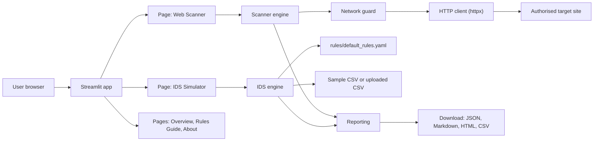
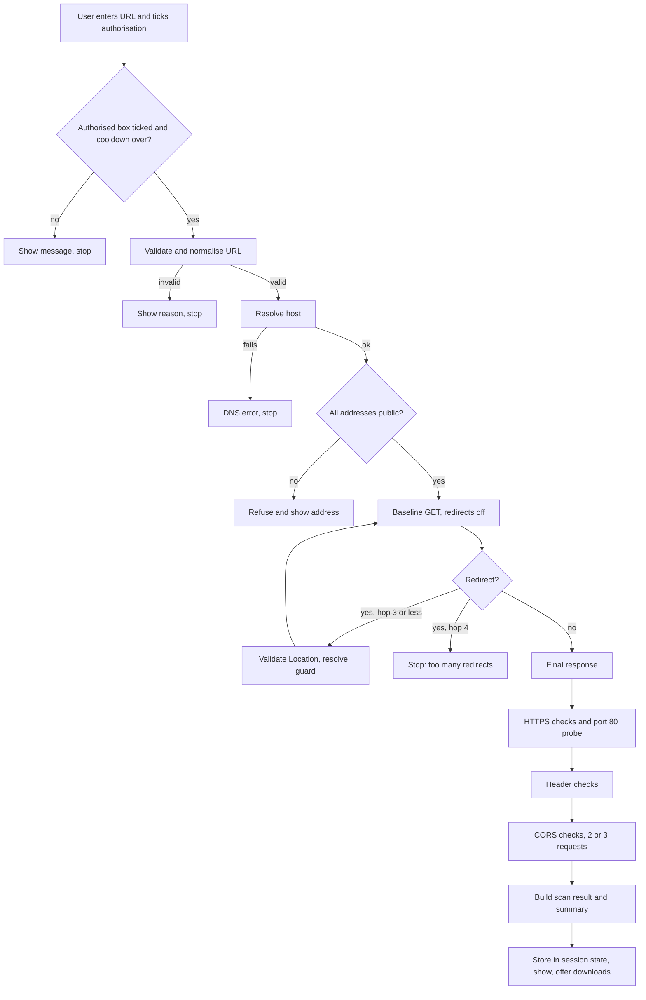
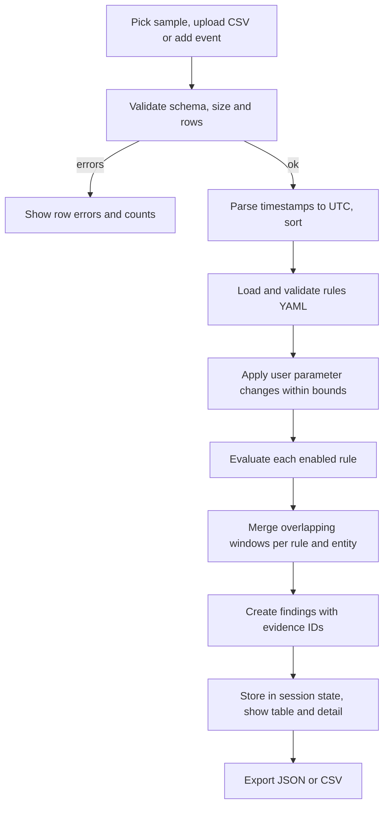
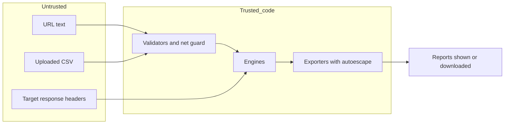

# Technical Requirements Document (TRD)

Product: Tellwarden (provisional name, pending clearance)
Version: 0.1 draft for approval
Date: 25 October 2026
Based on: `PRD.md`. Security IDs (SEC-...) are in `SECURITY_AND_ETHICS.md`. Test IDs (TC-...) are in `TEST_PLAN.md`.
Evidence tags: see `README.md`. No application code exists yet. This document describes the design only.

## 1. Recommended architecture and rationale

A single Streamlit application with a thin interface layer and two independent engines.

| Layer | Responsibility |
|---|---|
| Interface (Streamlit pages) | Collect input, show results, hold session state. No security logic |
| Scanner engine | URL validation, network guard, HTTP client, check functions, orchestration |
| IDS engine | Event loading and validation, rule loading, rule evaluation |
| Reporting | Shared finding and report models, JSON, Markdown and HTML exporters |
| Configuration | Bounded settings read from environment variables |

Rationale **[Recommendation]**:

- Streamlit is synchronous and simple. A scan makes a handful of requests and the IDS processes a small table. This fits Streamlit well.
- Engines contain no Streamlit calls. They are plain Python modules that can be tested without a browser and reused later behind an API.
- The security-critical code (network guard and URL validator) sits in one small module with no UI dependency. This keeps it easy to review and test.
- No database. State lives in the Streamlit session. This removes a whole class of risk and setup work.
- No alternative framework is needed for this scope. FastAPI or Flask with a separate front end would only be justified for a multi-user public service. No evidence was gathered that this is required.



## 2. Streamlit client-server execution model

**[Docs, not re-fetched]** Confirm against the official Streamlit documentation for the pinned version.

- Streamlit runs the Python script on the server. Every widget interaction reruns the whole script from top to bottom.
- `st.session_state` keeps values per browser session across reruns. Scan results, uploaded data and cooldown timestamps live here.
- `st.cache_data` caches serialisable return values. `st.cache_resource` caches shared objects across all sessions and must be thread-safe. **Scan results are not cached** because they depend on live targets and the user's consent. The parsed rule file may use `st.cache_data`.
- Each session runs in its own thread. Engine code must not rely on shared mutable globals.
- A scan runs only inside a button-press branch. The result is written to session state and displayed from session state, so reruns do not repeat requests (SCN-12).
- `st.file_uploader` holds files in memory and defaults to a 200 MB limit. The app sets a 5 MB limit in `config.toml` (`server.maxUploadSize`) and checks the size again in code **[verify the key against the pinned version]**.
- `st.download_button` serves bytes generated in memory.
- Navigation uses `st.navigation(pages, position="hidden")` with `st.Page` routing and a custom right-side drawer component (Option B) for responsive client-side navigation.
- Config note (Owner overrides O-1, O-2, 25 October 2026): `.streamlit/config.toml` configures self-hosted DM Sans and IBM Plex Mono fonts via `[[theme.fontFaces]]`, `[server] enableStaticServing = true`, and minimal toolbar `[client] toolbarMode = "minimal"`.
- Streamlit has no background jobs. All work must finish within the request. This is why the scan deadline is 20 s.

## 3. Directory and file structure

See `PROJECT_STRUCTURE.md` for the full tree and the purpose of every file. Summary:

```
tellwarden/
  app.py                      entry point and navigation
  src/tellwarden/
    config.py                 bounded settings
    scanner/                  url_validator, net_guard, http_client, checks, orchestrator
    ids/                      events, rule_loader, engine
    reporting/                models, exporters, templates
    ui/                       theme, components, nav, shell, views
  rules/default_rules.yaml    detection rules as data
  data/sample_events/         bundled demo CSV files
  static/fonts/               self-hosted DM Sans and IBM Plex Mono
  .streamlit/config.toml      theme and server limits
  tests/                      unit, integration, fixtures
```

## 4. Module responsibilities

| Module | Responsibility | Depends on |
|---|---|---|
| `config` | Read environment variables, apply bounds, expose constants. Never exposes any switch for the address blocklist | stdlib |
| `scanner.url_validator` | Normalise and validate the user URL (SEC-01, SEC-02) | stdlib `urllib.parse`, `ipaddress` |
| `scanner.net_guard` | Resolve hostnames, classify addresses, decide allow or refuse (SEC-03, SEC-04). Takes an injectable resolver for tests | stdlib `socket`, `ipaddress` |
| `scanner.http_client` | Build the httpx client (timeouts, no auto redirect, TLS verify on, User-Agent), perform guarded requests, follow redirects manually (SEC-05 to SEC-08, SEC-10) | httpx, `net_guard` |
| `scanner.checks` | Pure functions that turn a response or an observation into check results (HTTPS, headers, CORS) | models |
| `scanner.orchestrator` | Run the scan sequence, enforce the request budget and deadline, collect results | all scanner modules |
| `ids.events` | Load bundled or uploaded CSV, validate schema, parse timestamps, report row errors (SEC-16) | pandas or csv |
| `ids.rule_loader` | Parse and validate the YAML rule file and bounds | PyYAML |
| `ids.engine` | Evaluate rules, merge windows, produce findings | models |
| `reporting.models` | Data classes for check results, scan results, events and findings | stdlib |
| `reporting.exporters` | JSON, Markdown, HTML and CSV export. Autoescape on. CSV formula neutralisation | Jinja2 |
| `ui.*` | Streamlit pages, theme loading, badges, banners | Streamlit |

## 5. Data flow

### 5.1 Web scanner



### 5.2 Rule-based IDS simulator



### 5.3 Data and trust boundaries



Everything that comes from a user or a target is untrusted, including header values that are later shown in the interface and in reports.

## 6. URL validation and safe HTTP request handling

Implements SEC-01 to SEC-08, SEC-10 and SEC-14. The steps below are a design, not code.

1. **Normalise:** strip whitespace. If there is no scheme, prepend `https://`. Reject input longer than 2048 characters.
2. **Parse and check:** scheme must be `http` or `https`. Reject userinfo (`user:pass@`). Allow only port 80 or 443 (default if absent). Host must be non-empty. Convert internationalised names to ASCII (IDNA). Reject numeric host forms that are not plain dotted quads or valid IPv6 literals (decimal, octal and hex IPv4 forms such as `2130706433` or `0177.0.0.1`).
3. **Refuse blocked names:** `localhost`, `metadata.google.internal` and names ending in `.localhost` or `.internal`.
4. **Resolve:** use `getaddrinfo` for IPv4 and IPv6. If resolution fails, stop.
5. **Classify every returned address.** Refuse if any one address is not a public global address. Unwrap IPv4-mapped IPv6 and re-check. The blocklist covers at least:

| Range | Reason |
|---|---|
| 0.0.0.0/8, 127.0.0.0/8, ::1, :: | Unspecified and loopback |
| 10.0.0.0/8, 172.16.0.0/12, 192.168.0.0/16, fc00::/7 | Private |
| 100.64.0.0/10 | Carrier-grade NAT |
| 169.254.0.0/16 (includes 169.254.169.254), fe80::/10 | Link-local and cloud metadata |
| fd00:ec2::254 | AWS IPv6 metadata |
| 198.18.0.0/15 | Benchmarking |
| 224.0.0.0/4, ff00::/8 | Multicast |
| 240.0.0.0/4 and other reserved blocks | Reserved |
| ::ffff:0:0/96 | IPv4-mapped (unwrap, then check) |
| 64:ff9b::/96 | NAT64 |

   Implementation guidance **[Recommendation]**: use the Python `ipaddress` module attributes (`is_global` and the `is_private`, `is_loopback`, `is_link_local`, `is_reserved`, `is_multicast`, `is_unspecified` flags) plus the explicit ranges above.
6. **Request:** httpx client with `follow_redirects` off, connect timeout 3 s, read timeout 5 s, TLS verification on, a User-Agent of the form `Tellwarden/<version> (educational scanner)`. GET with `stream` so the body is not read. Close the response without reading the body. Any body read is capped at 1 MB.
7. **Redirects:** if the status is 301, 302, 303, 307 or 308 and a `Location` is present, resolve it against the current URL, then repeat steps 1 to 5 for the new URL. At most 3 hops. A downgrade from https to http is recorded as a finding and still followed only if the hop passes all checks.
8. **Budget and deadline:** at most 10 requests per scan (SEC-10). Overall deadline 20 s (SEC-06). Stop cleanly when either is reached.

**Known limitation (rebinding):** the address is validated at step 5 and httpx resolves the name again when it connects. Optional hardening is to connect to the validated address with the correct SNI and Host header. This is recorded as decision D-10. It is required before any public hosting.

## 7. HTTPS and security-header inspection

**Sources:** OWASP Secure Headers Project and OWASP HTTP Headers Cheat Sheet **[Verified, see `REFERENCES.md`]**. Thresholds that go beyond those sources are **[Recommendation]**.

### 7.1 HTTPS checks

| Check ID | Check | Pass | Warning | Fail | Info |
|---|---|---|---|---|---|
| HTTPS-01 | Final URL scheme | Final URL is https | | Final URL is http | |
| HTTPS-02 | Certificate verification | Connection verified | | Verification error (header and CORS checks are skipped) | |
| HTTPS-03 | HTTP to HTTPS redirect (one request to `http://host/`, redirects off) | 301, 302, 307 or 308 to an https URL on the same host | HTTP answers 200 with no redirect | | Port 80 closed or timed out |
| HTTPS-04 | Redirect chain downgrade | No https to http hop in the chain | An https to http hop was seen | | |

### 7.2 Header checks

| Check ID | Header | Pass | Warning | Fail |
|---|---|---|---|---|
| HDR-01 | Strict-Transport-Security | `max-age` at least 31536000 and `includeSubDomains`. OWASP proposes 63072000 | Present but `max-age` under 1 year or no `includeSubDomains` | Missing on an https response. Not applicable on http (Info) |
| HDR-02 | Content-Security-Policy | Present. No `'unsafe-inline'`, `'unsafe-eval'` or `*` in `script-src` (or `default-src` if no `script-src`). `object-src 'none'`. `frame-ancestors` set | Present but weak, or only `Content-Security-Policy-Report-Only` | Missing |
| HDR-03 | X-Content-Type-Options | `nosniff` | | Missing or another value |
| HDR-04 | Framing protection | `frame-ancestors 'none'` or `'self'`, or `X-Frame-Options` DENY or SAMEORIGIN | `X-Frame-Options: ALLOW-FROM` (obsolete) | Neither present |
| HDR-05 | Referrer-Policy | `no-referrer`, `same-origin`, `strict-origin` or `strict-origin-when-cross-origin` | Missing, `origin`, `origin-when-cross-origin`, `no-referrer-when-downgrade` | `unsafe-url` |
| HDR-06 | Permissions-Policy | Present and restricts unused features | | Missing is Info |
| HDR-07 | Cross-Origin-Opener-Policy | `same-origin` | `same-origin-allow-popups` | Missing is Info |
| HDR-08 | Cross-Origin-Resource-Policy | `same-origin` or `same-site` | | Missing is Info |
| HDR-09 | Cache-Control (only if the response sets a cookie) | `no-store` | `private` or `no-cache` only | Missing on a response that sets a cookie |
| HDR-10 | Server and X-Powered-By | Absent or generic | Product name only | Never Fail. Version number disclosed is Warning |
| HDR-11 | X-XSS-Protection | Absent or `0` | `1; mode=block` | |

Notes:

- Cross-origin isolation headers (COOP, CORP) are situational, so a missing value is Info and not a failure.
- HDR-06 to HDR-08 missing results are Info, so the Fail column is empty for them.
- Each result stores the observed value so the user sees exactly what the server sent.
- The summary shows counts only. It is a **configuration hygiene** view, not a security grade (SCN-10).

## 8. Safe, limited CORS assessment

**[Docs, not re-fetched]** OWASP Web Security Testing Guide (CORS testing) and MDN CORS guide. Confirm specifics before relying on them.

**Method (SEC-10):** at most 4 requests, all GET or OPTIONS, no body, no cookies, sent to the final URL with redirects off.

1. Baseline GET with no `Origin` (reuses the earlier baseline response, no extra request).
2. GET with `Origin: https://cors-check.invalid`.
3. GET with `Origin: null`.
4. Optional OPTIONS with `Origin` set to the test origin and `Access-Control-Request-Method: GET`.

If any of these requests returns a redirect, the CORS result is Info with the note "CORS not assessed, URL redirects".

| Check ID | Observation | Result |
|---|---|---|
| CORS-01 | No `Access-Control-Allow-Origin` on any request | Pass |
| CORS-02 | `Access-Control-Allow-Origin: *` without credentials | Info (fine for public assets) |
| CORS-03 | Test origin is reflected, no credentials allowed | Warning |
| CORS-04 | Test origin reflected and `Access-Control-Allow-Credentials: true` | Fail |
| CORS-05 | `null` origin allowed with credentials allowed | Fail |
| CORS-06 | `*` together with `Access-Control-Allow-Credentials: true` | Warning (invalid combination, browsers refuse it) |
| CORS-07 | Origin is reflected but there is no `Vary: Origin` | Warning (cache risk) |

**Limits shown in the UI:** only one URL and no login were tested. Other paths can behave differently. A result cannot show whether sensitive data is exposed. A Pass is not proof of safety.

## 9. Rule engine design and configurable detection rules

### 9.1 Design

- Rules live in `rules/default_rules.yaml` as data, in a simple format inspired by Sigma. Rule logic comes from a small set of built-in rule types. The file chooses a type and sets its parameters.
- Four rule types: `count_in_window`, `distinct_in_window`, `failures_then_success`, `time_of_day`.
- Events are sorted by timestamp. For each group, a sliding window moves across the events. When the condition holds, a finding starts. Consecutive windows for the same rule and entity merge into one finding with the earliest `first_seen`, the latest `last_seen` and the union of evidence event IDs (IDS-13).
- The engine is a pure function of events plus rules. Same input, same output (NFR-08).
- Each rule has bounds for every adjustable parameter. The UI cannot set values outside the bounds (IDS-05).

### 9.2 Rule file fields

`id`, `name`, `enabled`, `type`, `event_filter` (event type), `group_by`, `window_seconds`, `operator`, `threshold`, `params`, `severity`, `attack_technique`, `explanation`, `false_positives`, `response`, `bounds`.

### 9.3 Default rules

Thresholds are illustrative teaching defaults. **[Docs, not re-fetched]** The 5 failures in 10 minutes pattern matches the fail2ban default (`maxretry` 5, `findtime` 10 minutes). NIST SP 800-63B-4 allows up to 100 consecutive failures per account, so the defaults here are tighter and meant for detection, not for lockout policy. MITRE ATT&CK IDs are from the ATT&CK knowledge base.

| Rule ID | Name | Type | Logic and default | Bounds | Severity | ATT&CK |
|---|---|---|---|---|---|---|
| AUTH-001 | Brute force | `count_in_window` | At least 5 `auth_failure` events from one `src_ip` within 300 s | Threshold 2 to 50. Window 30 to 3600 s | High | T1110.001 |
| AUTH-002 | Password spraying | `distinct_in_window` | One `src_ip` has `auth_failure` against at least 10 distinct usernames within 600 s, each username tried at most 2 times | Distinct users 3 to 100. Window 60 to 3600 s. Per-user max 1 to 5 | High | T1110.003 |
| AUTH-003 | Success after failures | `failures_then_success` | An `auth_success` for a username from a `src_ip` that had at least 5 `auth_failure` events for that username from that `src_ip` in the previous 600 s | Failures 2 to 50. Window 60 to 3600 s | Critical | T1110, T1078 |
| AUTH-004 | Unusual hour login | `time_of_day` | `auth_success` outside 07:00 to 20:00 in the configured timezone (default UTC). Noisy by design | Start and end hour 0 to 23 | Low | T1078 |
| NET-001 | Vertical port scan | `distinct_in_window` | One `src_ip` contacts at least 15 distinct `dst_port` values on one `dst_ip` within 60 s (`conn` events) | Ports 5 to 200. Window 10 to 600 s | Medium | T1046 |
| NET-002 | Horizontal scan | `distinct_in_window` | One `src_ip` contacts at least 10 distinct `dst_ip` values on the same `dst_port` within 60 s (`conn` events) | Hosts 3 to 200. Window 10 to 600 s | Medium | T1046 |
| WEB-001 | Request burst | `count_in_window` | More than 100 `http_request` events from one `src_ip` within 60 s | Threshold 20 to 5000. Window 10 to 600 s | Medium | T1499 (indicative) |

The Rules Guide page shows, for each rule, the logic, the defaults, the bounds, known false positives and the recommended response.

## 10. Sample-event data schema

CSV with a header row. UTF-8. Maximum 5 MB and 50,000 rows.

| Column | Type | Required | Notes |
|---|---|---|---|
| `event_id` | string | Yes | Unique. If missing, the loader generates `row-<n>` |
| `timestamp` | ISO 8601 | Yes | Converted to UTC. Naive times are treated as UTC and noted |
| `event_type` | enum | Yes | `auth_success`, `auth_failure`, `conn`, `http_request` |
| `src_ip` | IP address | Yes | IPv4 or IPv6 |
| `dst_ip` | IP address | No | Required for `conn` events |
| `dst_port` | integer 0 to 65535 | No | Required for `conn` events |
| `protocol` | string | No | For example TCP, UDP, HTTP |
| `username` | string | No | Required for auth events. Length at most 128 |
| `service` | string | No | For example ssh, rdp, web |
| `status` | string | No | For example HTTP status code |
| `user_agent` | string | No | Length at most 256 |
| `bytes` | integer | No | |
| `dataset` | enum | No | `sample` or `uploaded`. Set by the loader |

All bundled sample data is synthetic. IP addresses in samples use documentation ranges (192.0.2.0/24, 198.51.100.0/24, 203.0.113.0/24) and `example` style usernames.

## 11. Finding and report data schemas

### 11.1 Check result (scanner)

`check_id`, `category` (https, header, cors), `title`, `status` (pass, warning, fail, info), `observed`, `expected`, `explanation`, `remediation`, `reference_url`.

### 11.2 Scan result

`tool`, `version`, `scan_id`, `started_at` (UTC), `finished_at` (UTC), `input_url`, `final_url`, `redirect_chain` (list of hop, status, location), `resolved_addresses`, `tls` (verified true or false, error text), `request_count`, `checks` (list of check results), `summary` (counts of pass, warning, fail, info), `limitations` (list of fixed strings), `authorization_confirmed` (true).

### 11.3 IDS finding

`finding_id`, `rule_id`, `rule_name`, `severity`, `attack_technique`, `entity` (ip, user or ip and user), `first_seen`, `last_seen`, `event_count`, `threshold`, `window_seconds`, `evidence_event_ids` (capped at 500 per finding, with a flag if truncated), `explanation`, `recommended_response`, `data_origin` (always "offline simulation").

### 11.4 IDS run result

`tool`, `version`, `run_id`, `ran_at` (UTC), `dataset_name`, `events_loaded`, `rows_skipped` (with reasons), `rules_applied` (ID and parameters used), `findings`, `limitations`.

## 12. Error handling, timeouts and dependency failures

| Failure | Handling |
|---|---|
| Validation failure | Exception type `ValidationError` carrying a user-safe message. The UI shows the message |
| Blocked address | `BlockedTargetError`, message includes the address and category |
| DNS failure | `ResolutionError` |
| Timeout, connection refused, reset | Mapped to a short text. The scan stops cleanly. Partial results already gathered are kept and marked incomplete |
| TLS error | HTTPS-02 Fail. Later network checks are skipped |
| Budget or deadline reached | Scan stops with the message "scan limit reached". Result marked incomplete |
| Unexpected exception | Caught at the page level. The user sees "Something went wrong". Details go to the log without the URL query string |
| Rule file invalid | `RuleConfigError`. IDS page shows the error and disables Run |
| CSV invalid | Row-level errors collected, first 20 shown, count shown |
| Missing optional dependency | Not applicable. All dependencies are required and listed in `requirements.txt` |

## 13. Report export format and approach

| Format | Approach | Notes |
|---|---|---|
| JSON | Serialise the scan result or run result directly | Canonical source. Validated against the schema in tests |
| Markdown | Template from the result | Good for GitHub. No styling |
| HTML | Jinja2 template with autoescape on. Inline CSS using the design system. No external assets | Self-contained. Prints to PDF from the browser |
| CSV (IDS findings) | Standard library `csv`. Cells starting with `=`, `+`, `-` or `@` get a leading apostrophe | SEC-16 |

PDF is out of scope for the MVP. File names: `tellwarden-scan-<host>-<UTC timestamp>.<ext>` and `tellwarden-ids-<dataset>-<UTC timestamp>.<ext>`. Host names are sanitised to letters, digits, dot and hyphen.

## 14. Dependency-management strategy

| Package | Use | Licence note |
|---|---|---|
| streamlit | Interface | Open source **[Assumption: confirm licence on the pinned release]** |
| httpx | HTTP client. Timeouts enforced by default. No automatic redirects. Certificate verification on | BSD-3-Clause **[Docs, not re-fetched]** |
| PyYAML | Rule file | MIT |
| Jinja2 | HTML and Markdown templates | BSD-3-Clause |
| pandas | CSV handling and tables (already a Streamlit dependency) | BSD-3-Clause |
| pytest, pytest-cov | Tests | Development only |
| respx | Mock httpx | Development only |
| pip-audit | Dependency audit | Development only |
| ruff (optional) | Lint and format | Development only |

Rules:

- Pin exact versions in `requirements.txt` at the start of development and record them in `DECISIONS_AND_ASSUMPTIONS.md`.
- Keep development packages in `requirements-dev.txt`.
- Run `pip-audit` before each release (SEC-18).
- Add a new dependency only with a written reason.
- Python 3.10 or newer **[Assumption]**. Confirm against the pinned Streamlit version.

## 15. Configuration and environment variables

All values are optional and bounded. An out-of-range value falls back to the default and logs a warning. **No variable can relax the address blocklist (SEC-14).**

| Variable | Default | Allowed range | Meaning |
|---|---|---|---|
| `TELLWARDEN_CONNECT_TIMEOUT` | 3 | 1 to 10 s | Connect timeout |
| `TELLWARDEN_READ_TIMEOUT` | 5 | 1 to 15 s | Read timeout |
| `TELLWARDEN_SCAN_DEADLINE` | 20 | 5 to 60 s | Overall scan deadline |
| `TELLWARDEN_MAX_REDIRECTS` | 3 | 0 to 5 | Redirect limit |
| `TELLWARDEN_MAX_REQUESTS` | 10 | 1 to 10 | Request budget |
| `TELLWARDEN_MAX_BODY_BYTES` | 1048576 | 1 KB to 1 MB | Body read cap |
| `TELLWARDEN_COOLDOWN_SECONDS` | 10 | 5 to 120 | Time between scans per session |
| `TELLWARDEN_MAX_UPLOAD_MB` | 5 | 1 to 10 | CSV size limit |
| `TELLWARDEN_MAX_EVENTS` | 50000 | 1000 to 100000 | CSV row limit |
| `TELLWARDEN_LOG_LEVEL` | INFO | DEBUG, INFO, WARNING, ERROR | Logging level |

Streamlit settings are in `.streamlit/config.toml`: theme colours and fonts from `DESIGN_SYSTEM.md`, `server.maxUploadSize`, `server.enableStaticServing`. **[Docs, not re-fetched]** The theme keys and `[[theme.fontFaces]]` have changed across recent Streamlit versions, so confirm them against the pinned version.

## 16. Logging and privacy considerations

- Python `logging` to standard error. No log files by default.
- Allowed in logs: UTC timestamp, scan ID, target host name, result counts, error type.
- Never logged: full URLs with paths or queries, header values, response content, uploaded file content, usernames or IP addresses from uploaded data.
- Session data is held in memory and lost when the session ends (SEC-13).
- Tests check that a log capture of a scan does not contain the URL path or query (TC-SEC-01).

## 17. Testing strategy

Full detail is in `TEST_PLAN.md`. Summary:

- **Unit tests:** URL validator, address classifier (parametrised SSRF cases), check functions (table-driven), rule engine (exact threshold, one below, window boundary), loaders, exporters.
- **Integration tests:** scanner against local servers on 127.0.0.1 (using an injected resolver and a test-only guard bypass that exists only in test code and not in the shipped configuration surface), mocked httpx responses with `respx`, slow and oversized responses.
- **UI tests:** Streamlit `AppTest` for the main flows **[Docs, not re-fetched]**.
- **Accessibility:** automated contrast computation plus manual keyboard, zoom and status-without-colour checks.
- **Documentation tests:** banned-claim scan, colour and font consistency, requirement-to-test mapping.

## 18. Local execution and optional deployment

- **Local:** create a virtual environment, `pip install -r requirements.txt`, `streamlit run app.py`.
- **Optional deployment:** not part of the MVP. Streamlit Community Cloud or a container host can run the app. **A public deployment must first pass the gate in `SECURITY_AND_ETHICS.md` section 6** (pinned-IP connection, egress filtering, rate limiting, authentication, sandbox). A deployment of only Module B, with no scanner, carries no SSRF risk and could be published earlier. That split would need a decision in `DECISIONS_AND_ASSUMPTIONS.md`.

## 19. Limitations and future architecture improvements

**Limitations:** single URL, no login, no crawling, headers and CORS only, DNS rebinding window in the MVP, synchronous execution, session-only state, illustrative rule thresholds, offline sample data only.

**Future improvements:**

- Pinned-IP connection (closes the rebinding window).
- Move engines behind a small API (FastAPI) if a separate front end is ever needed.
- Rule import in a Sigma-like format and rule tests in the UI.
- PDF export.
- A queue and worker for long scans if a public service is ever built.
- Optional storage of scan history with explicit user consent.
